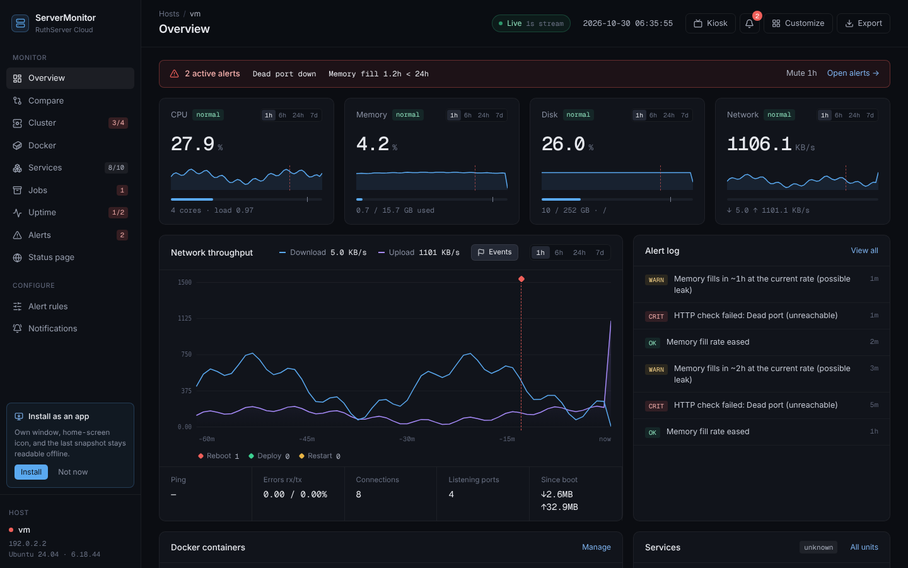

# ServerMonitor

A self-hosted, real-time server monitoring dashboard built with Next.js. It
reads live system metrics (CPU, memory, disk, network, temperature, fan
speed, uptime, top processes) from the host it runs on and exposes them
through a small dashboard UI and a JSON API, with an optional cluster view
that aggregates several nodes on one screen.



## Features

- **Live dashboard** (`/`) — one responsive layout, from a phone to a 7-inch
  kiosk panel (see [Layout](#layout)), fed once a second over a single
  Server-Sent Events stream (`/api/system/stream`):
  - CPU/GPU/RAM/disk gauges, per-core bars, and a 24-hour hourly load heatmap
  - load average with a 48-hour history grid, swap, and disk I/O throughput
  - network throughput chart, interfaces, link utilisation, ping, error
    rates, established connections and listening ports
  - temperature against its alert threshold, fan RPM, uptime and last reboot
  - 24-hour trend history per metric (memory/disk/temp/network), persisted like
    the load/CPU history, plus host-health signals — failed systemd services,
    read-only mounts, disk SMART health/temperature, pending (security) package
    updates, kernel error count, and failed-SSH-login count — surfaced in the
    banner and exported via `/api/metrics`
  - alert log, top processes, SSH sessions, top traffic peers, firewall state
  - keeps the last known values on screen when the stream drops, and says so
    in the header instead of blanking the display
- **Services** (`/services`) — every loaded systemd service with its state,
  sub-state and how long it has been up, a running/stopped filter, search, and
  per-unit logs (`journalctl -u`) in a side drawer with level filter, follow
  and download.
- **Docker** (`/docker`) — containers with live CPU/memory/network, an
  inspector (ports, networks, mounts, restart policy, health, command, memory
  limit) and container logs, plus images, volumes and networks with what uses
  them, and Docker's disk usage with what pruning would reclaim.
- **Jobs** (`/jobs`) — backups and scheduled jobs from crontab and systemd
  timers: schedule in words (*Daily at 03:30*) and as written, where it comes
  from (`systemd timer`, `crontab (root)`, `cron.daily`, …), last run and how
  long it took, the result, the last 14 runs, next run, and the output of the
  most recent run in the log drawer. A failed backup raises a critical alert,
  any other failed job a warning. `JOBS_CONFIG` renames, classifies or hides
  jobs. Cron doesn't record exit codes, so a cron job reads *Failed* only when
  cron logged a failure for it and *unknown* otherwise; Run now and
  Enable/Disable are offered for timers only.
- **Uptime** (`/uptime`) — HTTP checks run by the server on their own
  schedule (10s/30s/60s/5m): add, pause, *Check now* or delete an endpoint and
  see its status code, response time and last 60 results. A new check expects
  `200` exactly; checks created before this setting existed keep accepting any
  2xx/3xx (*expects 2xx*). A failing check
  raises a critical alert. Checks live in `data/uptime.json`.
- **Compare** (`/compare`) — CPU, memory, disk, network or load for today,
  this week or this month against the previous period: average, 95th
  percentile and peak with the change, an overlaid chart, and per-block
  averages. The day view uses 15-minute buckets (96 points, kept 8 days);
  week and month use hourly buckets kept for `HISTORY_RETENTION_DAYS`
  (default 62). Peaks come from each bucket's recorded maximum, not its
  average.
- **Cluster view** (`/cluster`) — a compact grid that shows multiple
  ServerMonitor instances (e.g. an x86 server plus several Raspberry Pi
  nodes) side by side. The browser polls a single same-origin endpoint
  (`/api/cluster`); the server fans out to each node, so node IPs stay
  server-side and nodes no longer need to CORS-allow the dashboard origin.
- **Public status page** (`/status`) — a sanitised, uptime-style summary safe to
  share externally: a status word, rounded CPU/memory/disk/GPU, outbound ping
  latency, load average, uptime, and an active-alert count. It exposes **no**
  reconnaissance data (no IPs, process names, ports, alert messages, GPU model
  name, or core count) and stays reachable even when `/api/system` is
  token-gated.
- **Wall-panel touches** — optional desktop notifications + a beep on a new
  critical alert (switch in the bell menu), a one-click JSON snapshot export,
  and a click-through / deep-linkable (`/cluster?node=<name>`) node detail
  dialog on the cluster view.
- **Kiosk view** (`/monitor`, or the header's *Kiosk* button) — a 1280×720
  stage scaled to the screen, alternating between this host and the cluster
  (`?rotate=<seconds>`, default 30, `0` = off), meant for a screen physically
  attached to this host. With
  `KIOSK_BYPASS_ENABLED` set, it (and every other route) skips
  `DASHBOARD_PASSWORD`/`API_AUTH_TOKEN` for requests that genuinely arrive over
  `127.0.0.1` — see [Securing the API](#securing-the-api).
- **JSON API** (`/api/system`) — returns the current metrics for the host,
  with a configurable CORS allow-list for cross-node requests.
- **Capacity planning** — a disk/memory forecast fits a 14-day linear trend
  to the persisted hourly history (needs at least 3 days), shows the growth per
  day with a daily sparkline and when it would fill, so a slow leak or a
  growing log directory shows up before it becomes an outage.
- **Monthly bandwidth** (`/api/bandwidth`) — daily download/upload totals
  derived from the network interface's cumulative counters, kept for 90 days,
  for tracking usage against an ISP data cap. Days start at local midnight
  (the server's time zone).
- **Event markers** — reboots (and whether a kernel update caused them),
  container restarts and exits with their exit code, unit restarts, app
  deploys and control actions are recorded in `data/events.json` and drawn on
  the charts. On first start past reboots are backfilled from `last -x`.
- **Installable (PWA)** — *Install as an app* in the sidebar (or the
  browser's own install entry) adds the console to a phone/desktop. The
  service worker caches only the page shell (network-first); live data never
  comes from a cache. The last sample is kept in the browser, so the app opened
  offline shows it under the offline banner and reconnects on its own.
- **Control actions (opt-in)** — start/stop/restart containers, restart
  units, run or toggle jobs and prune Docker from the console, behind login,
  an address allowlist and per-target allowlists. Off by default; see
  [Control actions](#control-actions-opt-in).
- **Kiosk launch script** — boots the dashboard full-screen in Firefox for
  a dedicated status display.

## Layout

### Console shell

Every authenticated page (`/`, `/compare`, `/cluster`, `/docker`, `/services`,
`/jobs`, `/uptime`, `/alerts`, `/alerts/incidents/<id>`, `/settings/rules`,
`/settings/notifications`, `/status-preview`) renders inside one console frame
(`src/app/(console)/layout.tsx`):

- **Sidebar** — Monitor / Configure navigation with live badges (active alert
  count), an *Install as an app* card, and the host block (hostname, address,
  OS · kernel, *Sign out* when `DASHBOARD_PASSWORD` login is on). Below 900px
  it becomes an off-canvas drawer behind the header's menu button.
- **Header** — breadcrumb and page title, connection state (*Live*,
  *Reconnecting…*), muted / quiet-hours pill, clock, and the *Kiosk*, bell and
  page actions (*Export* on the overview). The bell lists the latest critical
  and warning alerts and holds the per-browser sound/desktop-alert switch.
- **Offline banner** — when the stream drops (or goes silent for 10s) the page
  keeps the last sample on screen and says when it was received.

All pages share one SSE subscription (`SystemDataProvider`). The colours and
type come from the semantic tokens at the top of `src/styles/globals.css`,
mirrored as `PALETTE` in `src/lib/theme.ts`. The public `/status`, `/login`
and the wall display `/monitor` sit outside the shell — point a 7-inch panel at
`/monitor`, which keeps the full width.

### Overview

`/` opens with a status banner (active alerts with *Mute 1h*, a muted state,
breaches waiting out the fire delay, or *All systems normal* with failed
units, suppressed spikes, uptime and last reboot), then these panels in order:

| Row | Panels |
| --- | --- |
| 1 | Key metrics — CPU, memory, disk, network cards with a per-card 1h/6h/24h/7d sparkline and the alert threshold marked on the bar |
| 2 | Network throughput (range picker, reboot/deploy/restart markers) · Alert log |
| 3 | Docker containers · Services (failed units) |
| 3b | Backups & scheduled jobs (last good backup, last/next run, result) |
| 4 | CPU & load (per-core bars, 24h CPU and 48h load heatmaps) · Top processes |
| 5 | Bandwidth by day (30/90 days) · Capacity forecast |
| 6 | Hardware · Interfaces · Security |

*Customize* (header, or the link under the panels) hides panels per browser,
with *All / Essentials / Minimal* presets. Rows wrap as the window narrows.

The sparklines and charts read `/api/history?range=1h|6h|24h|7d` — persisted
one-minute samples for 1h/6h, 15-minute buckets for 24h (96 points) and hourly
buckets for 7d — and the markers read `/api/events` (reboots, container
restarts and exits, unit restarts, deploys, kept 30 days in
`data/events.json`). `/api/history/range` (Compare, `step=1h|15m`,
`stat=avg|max`) and `/api/history/window` (incident charts, finest resolution
still kept) read the same store.

### `/monitor` kiosk

`/monitor` draws a fixed 1280×720 stage scaled to fit the window (a 1024×600
panel shows it at 0.8×), with no hover-only interactions:

- **Host view** — CPU, memory, disk and CPU-temperature tiles, a 60-second
  network chart, and a strip with uptime, load, ping, containers, failed units
  and HTTP checks up. An alert bar appears above it while anything is firing.
- **Cluster view** — one tile per node with CPU/RAM/disk bars, temperature and
  ping, or the reason it's offline.

The header shows the countdown to the next view, the rotation choice
(10s/30s/60s/off), *Switch*, the clock and *Exit*. `src/components/kiosk/KioskScreen.tsx`
is the source of truth for this layout.

### Differences from the design mock-up

The console follows `Dashboard_Pro` closely; these differences are deliberate:

- Pages are App Router routes (`/docker`, `/alerts/incidents/<id>`, …) rather
  than `#hash` views, so links are shareable and login redirects keep the
  page; the kiosk is the `/monitor` route.
- Notifications go to browser push and webhooks only — there is no email
  channel.
- Control actions are off unless enabled, and destructive ones (stop, prune,
  image removal, unit restart) ask for confirmation.
- Cron jobs can't be run or toggled from the console, and their result is
  *unknown* unless cron logged a failure (stock cron doesn't record exit
  codes).
- HTTP checks also offer a 5-minute interval, and a check set to *expects 2xx*
  accepts any 2xx/3xx answer.
- The live pill reads *stream*: data arrives over Server-Sent Events, not by
  polling.
- Incident notes and actions are attributed to *operator* — there are no user
  accounts.
- Process names are the kernel's `comm` (15 characters); full command lines
  can carry secrets and are not shown.

## Tech stack

- [Next.js](https://nextjs.org) (App Router) + React + TypeScript
- Tailwind CSS
- Hand-rolled SVG charts on the main dashboard (viewBox-based, so they scale
  with the card instead of being measured); Recharts on the cluster view
- `src/utils/systemMonitor.ts` and `src/utils/collectors/*`, which read
  metrics straight from `/proc` and `/sys` and shell out only for `df`, `ps`,
  `ping`, `last`, `systemctl`, `journalctl` and `who` (SSH sessions are
  detected from `/proc` first, with `who` as a fallback)

## Getting started

### Prerequisites

- Node.js 18+
- A Linux host (metrics come from `/proc/stat`, `/proc/meminfo`,
  `/proc/net/route`, `/sys/class/net`, `/sys/class/thermal`, …)
- `lm-sensors` is optional. Install it for per-chip temperatures and fan RPM;
  without it those fall back to `/sys/class/thermal` and `/sys/class/hwmon`,
  and anything still unavailable reads `N/A` rather than zeroing the dashboard

Every panel degrades to `N/A` (never to a fake zero) when its source is
missing. A few need more than `/proc` to show real numbers:

| Panel | Needs |
| --- | --- |
| GPU usage/temperature | an AMD card (`gpu_busy_percent` in sysfs) or `nvidia-smi`. Intel iGPUs have no percentage to read, so they stay `N/A`. |
| Top traffic IPs (in bytes) | `nf_conntrack` with `net.netfilter.nf_conntrack_acct=1`. Without it the panel ranks peers by open connections instead. |
| Firewall blocked attempts | read access to the kernel journal (usually membership in `systemd-journal` or `adm`). |
| Services page | `systemctl` (systemd 247+ for the "since" column). |
| Unit logs | read access to the journal (`systemd-journal` or `adm`). |
| Jobs page | `systemctl` for the timers, and journal read access (systemd 248+) for the run history. Cron jobs need readable `/etc/crontab`, `/etc/cron.d` and `/etc/cron.{hourly,daily,weekly,monthly}` (user crontabs in `/var/spool/cron/crontabs` only when readable), and cron logging to the journal (`-t CRON`) for last runs. In Docker, mount those paths and the journal read-only (see `docker-compose.yml`). |
| Docker page, container logs | the `docker` CLI and access to the Docker socket (the `docker` group, or the socket mounted into the container). |
| Last reboot reason | readable `/var/log/wtmp` and a `last` binary; reports whether the previous shutdown was clean. |
| SSH sessions | detected from sshd session processes (`/proc/<pid>/comm` + cmdline) and established connections on the SSH port(s), so it works without utmp and catches PTY-less sessions (scp/sftp). The remote IP is filled in from the socket when `/proc/<pid>/fd` is readable (own user, or root); otherwise it may read `—`. `who` is merged in as a fallback. Set `SSH_PORTS` if sshd listens somewhere other than 22 and can't read `sshd_config`. |

Metric history is kept in memory by the running process and persisted to
`data/minutes.json` (per-minute samples, 6 hours) and `data/history.json`
(15-minute buckets for 8 days, hourly buckets for `HISTORY_RETENTION_DAYS`),
so charts survive a restart or redeploy. Any stretch the server was actually down stays empty and
fills in again over time.

If a metric looks wrong on a real host, `./scripts/diagnose.sh` prints what
each of those sources actually returns, and `curl localhost:3000/api/system`
includes a `warnings` array naming any collector that failed.

### Install

```bash
npm install
```

### Configure environment variables

All environment-specific values (cluster node IPs, allowed CORS origins,
site metadata, kiosk settings) live in a single `.env` file instead of being
hardcoded, so the app can be reused across servers/domains without editing
source code.

```bash
cp .env.example .env
```

Then edit `.env` to match your own setup. See
[Environment variables](#environment-variables) below for what each value
does.

### Run

```bash
# development
npm run dev

# production
npm run build
npm run start
```

Open [http://localhost:3000](http://localhost:3000) for the single-server
dashboard, or `/cluster` for the multi-node view.

### Test

```bash
npm test
```

Vitest covers the pure logic that is easy to break silently and hard to notice
on a running host: the history buckets and their on-disk recovery, the 30-minute
rolling average, the colour scale, the CORS header rules, and the
`/proc/loadavg` parser (which cannot run on a non-Linux dev machine at all).
The shell-output collectors are not covered — they need a real host.

## Environment variables

`.env.example` documents every supported variable. `NEXT_PUBLIC_*` values are
inlined into the client bundle at build time (needed because the cluster
dashboard fetches other nodes directly from the browser); the rest are only
read on the server.

| Variable | Used in | Description |
| --- | --- | --- |
| `NEXT_PUBLIC_CLUSTER_SERVERS` | `src/config/clusterConfig.ts` | JSON array of `{ "name", "ip", "type" }` objects rendered on `/cluster`. `type` is `"intel"` or `"rpi"` and controls which sensors are read. `ip` is a base URL the dashboard appends `/api/system` to: a full URL with scheme (e.g. `https://status.example.com`, used as-is) or a bare host/IP (expanded with `NEXT_PUBLIC_CLUSTER_PROTOCOL`/`NEXT_PUBLIC_CLUSTER_PORT`). |
| `NEXT_PUBLIC_CLUSTER_PORT` | `src/config/clusterConfig.ts` | Port for **bare-host** cluster nodes' `/api/system` (default `3000`). Ignored for `ip` entries that already include a scheme. |
| `NEXT_PUBLIC_CLUSTER_PROTOCOL` | `src/config/clusterConfig.ts` | Scheme (`http`/`https`) for **bare-host** cluster nodes (default `http`). Ignored for `ip` entries that already include a scheme. |
| `ALLOWED_ORIGINS` | `src/app/api/system/route.ts` | Comma-separated list of origins allowed to call `/api/system` (CORS allow-list). CORS only limits cross-origin browser reads — it does not authenticate. See [Securing the API](#securing-the-api). |
| `API_AUTH_TOKEN` | `src/utils/apiAuth.ts` | Optional shared secret for machine-to-machine access. When set, every request to the sensitive routes (`/api/system*`, `/api/alerts*`, `/api/cluster`) must present it as `Authorization: Bearer <token>` or an `api_auth_token` cookie. Unset by default. On its own the built-in browser dashboard can't reach it (the browser has no way to attach the token, and `/login` is disabled unless `DASHBOARD_PASSWORD` is also set) — either also set `DASHBOARD_PASSWORD` to use the login page, or have a reverse proxy inject the token/cookie. See [Securing the API](#securing-the-api). |
| `DASHBOARD_PASSWORD` | `src/app/api/auth/login/route.ts` | Optional login password. **Set on its own it is enough to protect the dashboard** — `/login` verifies it and drops an HttpOnly `api_auth_token` cookie carrying a token *derived* from the password (the raw password never becomes the cookie value, and never reaches client JS). Anonymous requests to the sensitive routes then get `401`. Unset by default (no login page). |
| `RATE_LIMIT_RPM` | `src/utils/rateLimit.ts` | Per-IP request/minute cap on the public JSON endpoints (`/api/system`, `/api/metrics`, `/api/cluster`), protecting the collectors from a busy loop. `0` disables it. Default `300` — generous enough for cluster polling and several dashboards. |
| `RATE_LIMIT_TRUST_PROXY` | `src/utils/rateLimit.ts` | Whether rate limiting (including login/auth-failure attempts) reads `X-Forwarded-For`/`X-Real-IP` to key buckets per client IP. Off by default, meaning every caller shares one bucket — safe against abuse, but a self-DoS risk: one visitor spamming the wrong `DASHBOARD_PASSWORD` can temporarily lock out everyone else's login too. Turn on only behind a reverse proxy you control that overwrites these headers; never on a directly-exposed deployment (a client could otherwise mint a fresh "IP" per request and bypass the limit entirely). |
| `KIOSK_BYPASS_ENABLED` | `server.js`, `src/utils/apiAuth.ts` | Set to `1`/`true` to open a second HTTP listener bound to `127.0.0.1` only; requests that arrive through it skip `DASHBOARD_PASSWORD`/`API_AUTH_TOKEN` entirely. Only takes effect with `npm start`/`node server.js` (`next dev` never opens it). Unset by default. See [Securing the API](#securing-the-api). |
| `KIOSK_BYPASS_PORT` | `server.js` | Port for the loopback-only listener above. Must differ from `PORT`. Default `3001`. |
| `NEXT_PUBLIC_SITE_URL` | `src/config/siteConfig.ts` | Canonical site URL used for metadata, Open Graph tags, `robots.txt` and `sitemap.xml`. |
| `NEXT_PUBLIC_SITE_NAME` | `src/config/siteConfig.ts` | Full site/app name shown in page titles and metadata. |
| `NEXT_PUBLIC_SITE_SHORT_NAME` | `src/config/siteConfig.ts` | Short name used in the title template and mobile web app title. |
| `NEXT_PUBLIC_SITE_DESCRIPTION` | `src/config/siteConfig.ts` | Site description used in metadata and social previews. |
| `NEXT_PUBLIC_AUTHOR_NAME` | `src/config/siteConfig.ts` | Author/creator/publisher metadata. |
| `PING_HOST` | `src/utils/systemMonitor.ts` | Host pinged for the latency reading. Defaults to `8.8.8.8`; set it to a reachable host if outbound ICMP is blocked, otherwise ping shows `0`. |
| `HISTORY_RETENTION_DAYS` | `src/utils/collectors/history.ts` | Days of hourly history to keep, 7–400 (default `62`). Feeds Compare week/month and the 14-day capacity trend. |
| `ALERT_FIRE_DELAY_SECONDS` / `ALERT_RESOLVE_DELAY_SECONDS` | `src/utils/collectors/alerts.ts` | How long a threshold breach must hold before it alerts (default `30`) and how long recovery must hold before it clears (default `60`). `0` = immediately. Also editable at `/settings/rules`. |
| `JOBS_CONFIG` | `src/utils/collectors/jobConfig.ts` | JSON object keyed by timer unit or cron job id: `{ "name", "kind": "backup" \| "maintenance", "hidden" }`. |
| `CONTROL_ENABLED`, `CONTROL_ALLOWED_CIDRS`, `CONTROL_TRUST_PROXY`, `CONTROL_ALLOWLIST_CONTAINERS`, `CONTROL_ALLOWLIST_UNITS`, `CONTROL_ALLOW_PRUNE` | `src/utils/control.ts` | Opt-in control actions; see [Control actions](#control-actions-opt-in). |
| `DATA_DIR` and `*_FILE` (`HISTORY_FILE`, `MINUTES_FILE`, `UPTIME_FILE`, `INCIDENTS_FILE`, `NOTIFICATIONS_FILE`, `ALERTS_FILE`, `ALERT_OVERRIDES_FILE`, `EVENTS_FILE`, `BANDWIDTH_FILE`) | `src/utils/collectors/*` | Where persisted state lives (default `./data`). Override a file only to move it. |
| `LOG_LEVEL` | `src/utils/logger.ts` | Server log volume: `error`, `warn`, `info` (default) or `debug`. |
| `SSH_PORTS` | `src/utils/collectors/security.ts` | Comma-separated SSH port(s) used to match active sessions. Normally read from `sshd_config` with a fallback to `22`; set only if sshd listens elsewhere and the config isn't readable. |
| `KIOSK_USER` | `scripts/run.sh` | Linux user whose Firefox session is killed/relaunched in kiosk mode. |
| `KIOSK_URL` | `scripts/run.sh` | URL opened in kiosk mode. |

Adding, removing, or repointing a cluster node is now a one-line edit in
`.env` — no code changes or redeploy of the dashboard logic required.

## Bare-metal deploy (systemd)

To run ServerMonitor directly on a host (no Docker) as a service that starts on
boot and restarts on failure:

```bash
# /opt is root-owned, so create the target and hand it to your deploy user first
# (the installer then defaults RUN_USER to that owner rather than root).
sudo mkdir -p /opt/servermonitor
sudo chown "$USER" /opt/servermonitor
git clone https://github.com/Ruthgyeul/ServerMonitor.git /opt/servermonitor
cd /opt/servermonitor
cp .env.example .env   # edit as needed
sudo ./scripts/install.sh
```

`scripts/install.sh` checks for Node.js 18+, runs `npm ci` and `npm run build`
as the service user, creates the `data/` directory, then renders and installs
`deploy/servermonitor.service` into `/etc/systemd/system/` and enables it.

It is configurable via environment variables:

| Variable | Default | Purpose |
| --- | --- | --- |
| `RUN_USER` | the checkout's owner | Service account the app runs as |
| `PORT` | `3000` | Port to listen on |
| `SERVICE` | `servermonitor` | systemd unit name |

Then:

```bash
systemctl status servermonitor
journalctl -u servermonitor -f
sudo systemctl restart servermonitor   # after editing a server-only value in .env
```

`NEXT_PUBLIC_*` values (cluster servers, site metadata) are inlined at build
time, so changing one needs a **rebuild**, not just a restart — rerun the
installer, which rebuilds and restarts:

```bash
sudo ./scripts/install.sh
```

The unit adds the service user to the `systemd-journal` and `adm` groups so the
firewall / kernel-error / failed-login collectors can read the journal without
running as root. Running on bare metal (rather than in a container) is also what
lets the `systemctl`/`journalctl`/`who`/`last` collectors report real values.

## Alerting

Threshold rules evaluate every collection tick with hysteresis (separate enter/
clear values) so a value hovering at the line doesn't flood the log. Beyond the
core CPU/memory/disk/temperature/swap rules, the set covers **load per core**,
**GPU temperature**, **low battery**, **disk and memory fill-forecast** (hours
to full — the memory one catches a slow leak before it becomes an OOM kill), a
**port-scan detector** (a source IP hitting many distinct ports in a short
window, from the firewall log — see `PORT_SCAN_THRESHOLD`/`PORT_SCAN_WINDOW_MINUTES`),
and a composite **memory-pressure** rule (RAM and swap both high). Optional
**statistical anomaly detection** (`ALERT_ANOMALY_ENABLE`) flags CPU or memory
that departs sharply from its own recent baseline even under the absolute threshold.

Besides the metric rules, a failing **HTTP check** (`/uptime`), a failed
**scheduled job** (`/jobs`; critical for backups) and a **failed systemd unit**
raise alerts too, and clear when they recover.

**Alert timing** (off by default): a threshold breach can be required to hold
for a *fire delay* before it alerts — shorter breaches are logged as
*suppressed spikes* and don't notify — and an alert can be required to stay
recovered for a *resolve delay* before it clears
(`ALERT_FIRE_DELAY_SECONDS`, `ALERT_RESOLVE_DELAY_SECONDS`, or the *Alert
timing* section of `/settings/rules`).

Every alert shows on the dashboard's alert card and is persisted to
`data/alerts.json`. The **`/alerts`** page lists what is pending or recovering,
what is firing, the incidents, a 48-hour timeline and the full history with a
level filter and text search. Each firing opens an **incident**
(`/alerts/incidents/<id>`, kept 30 days in `data/incidents.json`) with a
timeline — fired, notified, acknowledged, notes, resolved, reopened — and the
metric around it; it resolves itself when the alert clears.
**`/settings/rules`** lets you tune any threshold from the browser — changes
apply on the next tick, no restart needed (they're stored in
`data/alert-overrides.json` and take priority over the matching `.env` value,
which stays the default).

**`/settings/notifications`** switches channels on and off — this browser's
desktop notifications and the webhook — chooses which levels they carry
(stored in `data/notifications.json`; every level is on by default), sends a
test message to the configured webhooks, and mutes for 1h/4h/24h.

Outbound notifications (off until `ALERT_WEBHOOK_URL` is set) support `json`,
`slack`, and `discord` shapes, **per-severity routing** (`ALERT_WEBHOOK_URL_CRITICAL`
etc.), and optional **batching** (`ALERT_BATCH_MS`). **Flapping suppression** stops
a rule that toggles rapidly from paging (it stays on the on-screen log). To
silence notifications during maintenance, set **quiet hours**
(`ALERT_QUIET_HOURS="22:00-07:00"`) or mute at runtime:

```bash
curl -X POST localhost:3000/api/alerts/mute -H 'Content-Type: application/json' -d '{"minutes":30}'
curl -X DELETE localhost:3000/api/alerts/mute   # lift early
```

All alert tuning lives in environment variables — see `.env.example`.

## Scripts

- `scripts/diagnose.sh` — prints the raw contents of every source the API
  reads, so you can see which metric is unavailable on a given host.
- `scripts/run.sh` — launches the dashboard full-screen in Firefox kiosk
  mode, reading `KIOSK_USER`/`KIOSK_URL` from `.env` if present.
- `scripts/monitor.sh` — standalone JSON dump of the same metrics. Not used by
  the API route; kept for shelling out from other tooling.

## Securing the API

`/api/system`, `/api/system/stream`, `/api/alerts*`, and `/api/cluster` return
sensitive host reconnaissance: SSH session source IPs and usernames, listening
ports, top traffic peer IPs, firewall state, and the running process list.
**These endpoints are unauthenticated by default**, and the `ALLOWED_ORIGINS`
CORS list only restricts cross-origin reads from browsers — it does nothing
against `curl` or any script. Anyone who can reach the port can read everything.

Pick at least one of these, in rough order of preference:

1. **Password login (simplest — protects the dashboard on its own).** Set
   `DASHBOARD_PASSWORD`. The `/login` page verifies it server-side and drops an
   HttpOnly `api_auth_token` cookie carrying a token *derived* from the password
   (the raw password never becomes the cookie value and never reaches client
   JavaScript). Anonymous requests to the sensitive routes then get `401`, and
   the browser dashboard works normally after login. `curl` without the cookie
   still gets `401`.
2. **Network isolation.** Bind the app to `localhost` and expose it only through
   a reverse proxy (nginx/Caddy/Traefik) that terminates TLS and enforces auth
   (Basic auth, mTLS, OAuth2 proxy), or keep it reachable only over a VPN /
   private network. This keeps the browser dashboard fully working.
3. **Token gate (machine-to-machine).** Set `API_AUTH_TOKEN`
   (e.g. `openssl rand -hex 32`). Every request to the sensitive routes then
   needs `Authorization: Bearer <token>` or an `api_auth_token` cookie. This
   suits machine-to-machine polling or a reverse proxy that injects the token.
   The browser dashboard still works via `/login` when `DASHBOARD_PASSWORD` is
   also set.

The gate runs inside the Node route handlers (`src/utils/apiAuth.ts`), so it
reads its configuration from the runtime environment on every request.

**Kiosk loopback bypass.** If a screen is physically attached to this host
(the `/monitor` kiosk view), set `KIOSK_BYPASS_ENABLED=1` to skip the gate for
that screen without weakening it for everyone else. `server.js` opens a second
listener bound to `127.0.0.1` (`KIOSK_BYPASS_PORT`, default `3001`); the OS
itself refuses any connection to it that didn't originate on this machine, so
there's nothing here that a network attacker can spoof (unlike trusting a
`Host`/`X-Forwarded-For` header, which this deliberately does not do). Point `KIOSK_URL` at `http://localhost:<KIOSK_BYPASS_PORT>/monitor`. This only
works under `npm start`/`node server.js` — `next dev` never opens this
listener. **Never**
reverse-proxy or port-forward `KIOSK_BYPASS_PORT` to anything other than this
same host; doing so would let whoever reaches the proxy skip the password too.

A coarse per-IP rate limit (`RATE_LIMIT_RPM`, default 300) also guards
`/api/system`, `/api/metrics`, and `/api/cluster` so an open deployment can't
be driven into a collection busy loop — `/api/cluster` matters especially,
since each hit fans out to every configured node. By default every caller
shares one bucket rather than being split per IP (see `RATE_LIMIT_TRUST_PROXY`
above for the trade-off and when it's safe to turn on).

The app also sends hardening response headers (`X-Frame-Options: DENY`,
`X-Content-Type-Options: nosniff`, a `frame-ancestors 'none'` CSP,
`Referrer-Policy`, `Permissions-Policy`, HSTS) from `next.config.ts`, and the
process list reports executable names only (never full command lines) so
secrets passed as CLI arguments are never exposed.

## Control actions (opt-in)

Off by default — the dashboard is read-only until you turn this on. When
enabled, the console can:

- **Docker** (`/docker`): start, stop, restart, pause and unpause containers;
  remove an unused image; prune unused images, anonymous volumes or the build
  cache.
- **Services** (`/services`, and failed units on the overview): restart a unit.
- **Jobs** (`/jobs`): *Run now* (starts the timer's service), enable or disable
  the timer.

Every request must pass all of these (`src/utils/control.ts`):

1. a valid login — `DASHBOARD_PASSWORD` (or `API_AUTH_TOKEN`) must be set; with
   no login configured, control stays off whatever else is set;
2. `CONTROL_ENABLED=true`;
3. not the kiosk's loopback connection, which stays read-only;
4. same-origin, and within a strict rate budget (about 10 actions a minute);
5. the caller's address inside `CONTROL_ALLOWED_CIDRS` (default
   `192.168.0.0/24`). The address comes from the socket via the bundled
   `server.js` (`npm start`) — a bare `next start` has no trustworthy address,
   so control is refused there. Behind a reverse proxy on the same host, set
   `CONTROL_TRUST_PROXY=true` to use its `X-Forwarded-For`;
6. the target in an allowlist: `CONTROL_ALLOWLIST_CONTAINERS` (container
   names), `CONTROL_ALLOWLIST_UNITS` (service units, and timers for jobs), or
   `CONTROL_ALLOW_PRUNE=true` for pruning and image removal. `*` allows every
   name — use it knowingly.

Commands run without a shell (`execFile` with an argument list). Stop, prune,
image removal, unit restart and disabling a job ask for confirmation first.
Each action, and its failure, is recorded in the alert history (never sent to
the webhook). Buttons stay visible but disabled, with the reason as a
tooltip, while the gate is closed.

**Permissions.** Docker actions need the Docker socket (the `docker` group).
`systemctl` changes need root: the service runs `sudo -n systemctl …`, so add
a sudoers rule for exactly the commands you allow —
`deploy/servermonitor.sudoers` is a template. The bundled unit sets
`NoNewPrivileges=true`, which stops `sudo`; to use unit and job actions, relax
it in a drop-in (`sudo systemctl edit servermonitor` →
`[Service]` / `NoNewPrivileges=false`) — the sudoers rule is then what limits
what can run. In the Docker image, mounting
`/var/run/docker.sock` gives the container control of the host's Docker
daemon, which is effectively root on the host; only do it if you want the
Docker actions.

## Deploying a cluster

Each node in `NEXT_PUBLIC_CLUSTER_SERVERS` should run its own instance of
this app so its `/api/system` endpoint is reachable at the node's base URL.
Give each node either a full base URL (`"ip": "https://status.example.com"`,
appended with `/api/system` as-is) or a bare host/IP (`"ip": "192.168.0.100"`,
reached at `<NEXT_PUBLIC_CLUSTER_PROTOCOL>://<ip>:<NEXT_PUBLIC_CLUSTER_PORT>`).

The `/cluster` page fetches a single same-origin endpoint (`/api/cluster`),
and the dashboard **server** fetches each node's `/api/system`. Because those
node requests are server-to-server, nodes no longer need to CORS-allow the
dashboard origin for the cluster view, and node IPs never reach the browser.
If the nodes are gated, the dashboard server forwards the token it expects
locally as the bearer token when polling each node — the raw `API_AUTH_TOKEN`
when set, otherwise the token derived from a shared `DASHBOARD_PASSWORD`. For a
gated cluster, give every node the same secret.

## Learn more

- [Next.js Documentation](https://nextjs.org/docs)
- [Learn Next.js](https://nextjs.org/learn)
